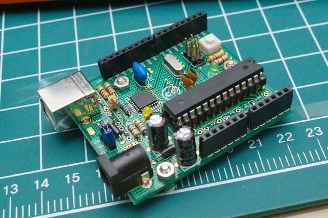

# HUMA - Freeduino

**HUMA** (HUman MAdeable Arduino)는 라디오 키트를 조립하듯 부품을 손수 납땜하여 완성할 수 있도록 설계된 오픈소스 아두이노 호환 보드(Freeduino 기반)입니다.

An open-source, Arduino-compatible board designed for makers to hand-solder and assemble themselves.

## Documentation / 문서

* [조립 설명서 (Assembly Guide)](site/index.html) - 부품 확인부터 납땜, 부트로더 굽기까지 단계별 안내
* [부품 목록 (Bill of Materials)](site/huma_bom.html) - 소요 부품 목록 및 단가 정보
* 온라인 문서: [https://suapapa.github.io/HUMA/](https://suapapa.github.io/HUMA/)

## Directories / 디렉터리 구조

* `eagle/` - EAGLE CAD 회로도 및 아트워크 파일 (`HUMA.sch`, `HUMA.brd`)
* `export/` - 거버 압축 파일 (`HUMA_R05_gerb.zip`) 및 회로도 이미지 (`HUMA_sch.png`)
* `gerber_conf/` - 거버 생성용 CAM 설정 및 패널 배치(`gerbmerge`) 파일
* `scripts/` - AVR 퓨즈 설정 및 부트로더 굽기 스크립트 (ATmega8, Diecimila 등)
* `site/` - 조립 설명서 및 부품 목록 웹사이트 소스 (GitHub Pages)

## License

* [CC BY-SA 3.0](LICENSE)
